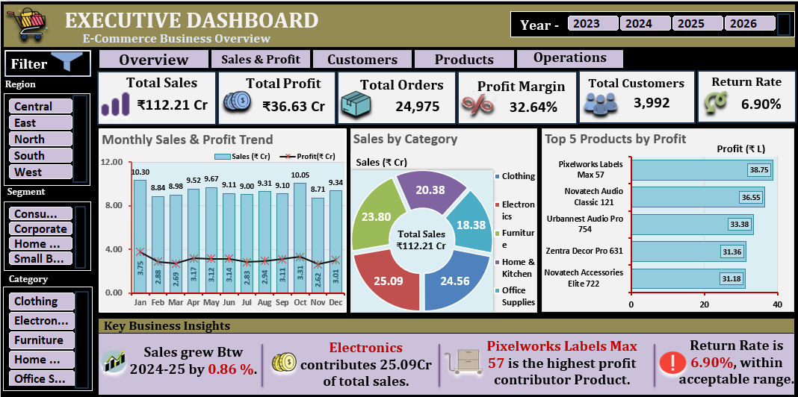
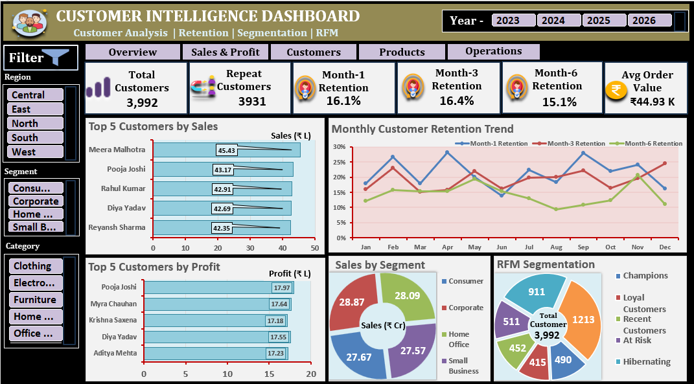
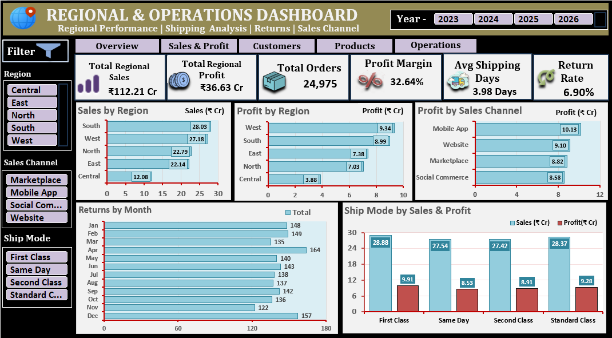

# E-Commerce Sales Analytics Project | Microsoft Excel

An end-to-end E-Commerce Business Analytics project developed using Microsoft Excel, covering data cleaning, business analysis, customer intelligence, inventory analysis, and interactive dashboard reporting.

## Project Overview

The objective of this project is to transform raw e-commerce data into meaningful business insights and provide management with a clear view of sales performance, profitability, customer behaviour, product performance, and operations.

## Tools & Technologies

- Microsoft Excel
- Excel Tables and Formulas
- PivotTables and PivotCharts
- Excel Data Model and Relationships
- Slicers and Interactive Filters
- Data Cleaning and Business Analysis

## Dataset

The project uses four datasets:

| Dataset | Description |
|---|---|
| Orders | Order transactions, sales, quantity, discount and profit |
| Customers | Customer information and segmentation |
| Products | Product categories, pricing and inventory |
| Returns | Return transactions and refund information |

### Dataset Files

- `Raw_Dataset.xlsx` — Original raw datasets.
- `Clean_Dataset.xlsx` — Cleaned datasets.

## Dashboard Previews

### 1. Executive Dashboard

Overall business performance, sales, profit, orders, customers and key business indicators.

### 2. Sales & Profit Dashboard

Sales trends, profitability, category performance and discount-related insights.

### 3. Customer Intelligence Dashboard

Customer performance, retention, RFM segmentation and churn analysis.

### 4. Product & Inventory Dashboard

Product performance, inventory levels, product status and stock-related insights.

### 5. Regional & Operations Dashboard

Regional performance, shipping operations, returns and sales channel analysis.

## Business Analysis Areas

1. Sales Analysis
2. Profitability Analysis
3. Product Analysis
4. Customer Analysis
5. Customer Retention Analysis
6. RFM Analysis
7. Regional Analysis
8. Shipping & Operations Analysis
9. Returns Analysis
10. Sales Channel Analysis
11. Discount Analysis
12. Inventory Analysis
13. Sales Forecasting
14. Customer Churn Analysis
15. Scenario & What-If Analysis
16. Business Investigation

## Key Business Findings

- Total Sales: ₹112.21 Crore
- Total Profit: ₹36.63 Crore
- Profit Margin: Approximately 32.64%
- Customer retention was evaluated across multiple cohort periods.
- Discontinued inventory and potential stock risks were investigated.
- Discount-related profitability and regional performance were evaluated.
- Sales forecasting was performed using a 3-month moving average.

## Interactive Dashboard Features

- Year-based filtering
- Region and category filters
- Customer segment filters
- Interactive KPI cards and charts
- Business performance comparisons

## How to Explore

1. Download the raw dataset to explore the original data.
2. Download the cleaned dataset to explore the prepared data.
3. View the dashboard screenshots for a visual overview.
4. Review the business analysis areas to understand the scope of the project.

## Project Objective

This project demonstrates practical Excel skills in data cleaning, data modelling, business analysis, dashboard development, and management reporting.

---

**Project Category:** E-Commerce Business Analytics  
**Tool:** Microsoft Excel
