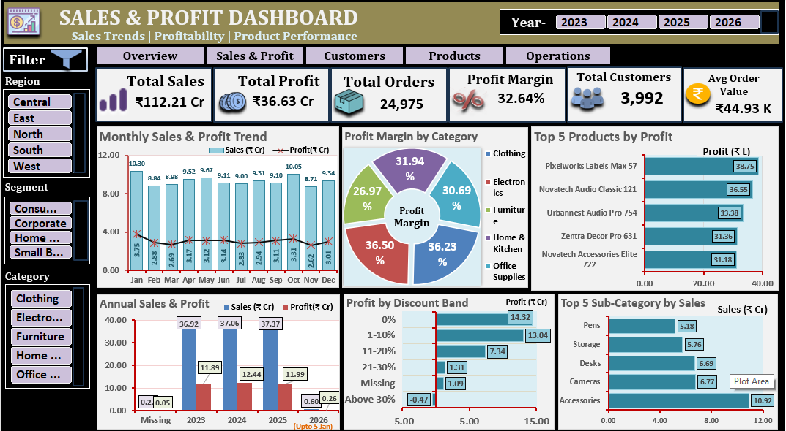
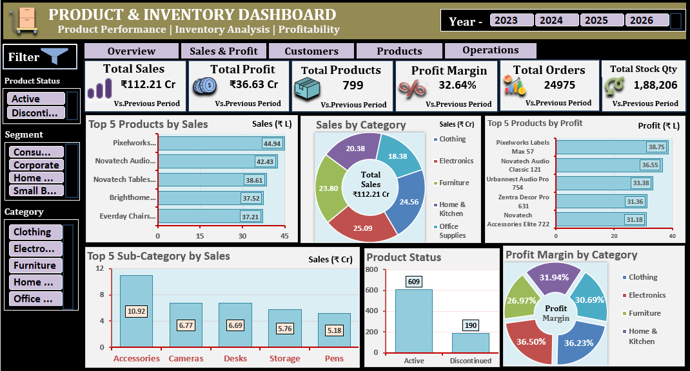

# E-Commerce Sales Analytics Project | Microsoft Excel

An end-to-end E-Commerce Business Analytics project developed using Microsoft Excel. This project covers data cleaning, data modelling, business analysis, customer intelligence, inventory evaluation, and interactive dashboard reporting.

## Project Overview

The objective of this project is to transform raw e-commerce data into meaningful business insights and support management decision-making through analytical reporting and interactive dashboards.

The project includes raw and cleaned datasets, 16 business analysis areas, and five interactive dashboard reports.

## Tools & Technologies

- Microsoft Excel
- Excel Tables and Formulas
- PivotTables and PivotCharts
- Excel Data Model and Relationships
- Slicers and Interactive Filters
- Data Cleaning
- Business and Customer Analytics

## Dataset Description

The project uses four datasets:

| Dataset | Description |
|---|---|
| Orders | Order transactions, sales, quantity, discounts and profit |
| Customers | Customer details and segmentation |
| Products | Product categories, pricing and inventory |
| Returns | Return transactions and refund information |

### Dataset Files

- `Raw_Dataset.xlsx` — Original raw datasets.
- `Clean_Dataset.xlsx` — Cleaned datasets.

## Dashboard Previews

### 1. Executive Dashboard

Provides an overview of business performance through key metrics, sales, profit, orders, customers, and other business indicators.


### 2. Sales & Profit Dashboard

Analyzes sales trends, profitability, category performance, and discount-related insights.



### 3. Customer Intelligence Dashboard

Focuses on customer performance, retention, RFM segmentation, and churn analysis.


### 4. Product & Inventory Dashboard

Evaluates product performance, inventory levels, product status, and stock-related risks.



### 5. Regional & Operations Dashboard

Analyzes regional performance, shipping operations, returns, and sales channel performance.


## Business Analysis Areas

The project covers the following 16 analysis areas:

1. Sales Analysis
2. Profitability Analysis
3. Product Analysis
4. Customer Analysis
5. Customer Retention Analysis
6. RFM Analysis
7. Regional Analysis
8. Shipping & Operations Analysis
9. Returns Analysis
10. Sales Channel Analysis
11. Discount Analysis
12. Inventory Analysis
13. Sales Forecasting
14. Customer Churn Analysis
15. Scenario & What-If Analysis
16. Business Investigation

## Key Business Findings

- Total Sales: ₹112.21 Crore
- Total Profit: ₹36.63 Crore
- Overall Profit Margin: Approximately 32.64%
- Customer retention was evaluated across multiple cohort periods.
- Discount-related profitability was investigated.
- Discontinued inventory and potential stock risks were identified.
- Sales forecasting was performed using a 3-month moving average.

## Interactive Dashboard Features

- Year-based filtering
- Region, category, and customer segment filters
- Interactive KPI cards and charts
- Business performance comparisons
- Dashboard-level filtering and exploration

## Repository Structure

```text
ecommerce-sales-analytics-excel/
│
├── Raw_Dataset.xlsx
├── Clean_Dataset.xlsx
│
├── Dashboard_Screenshots/
│   ├── 01_Executive_Dashboard.png
│   ├── 02_Sales_Profit_Dashboard.png
│   ├── 03_Customer_Intelligence_Dashboard.png
│   ├── 04_Product_Inventory_Dashboard.png
│   └── 05_Regional_Operations_Dashboard.png
│
└── README.md
```

## How to Explore

1. Download the raw dataset to explore the original data.
2. Download the cleaned dataset to explore the prepared data.
3. View the dashboard previews above.
4. Review the analysis areas to understand the business questions covered by the project.

## Project Objective

This project demonstrates practical Microsoft Excel skills in data cleaning, data modelling, business analysis, dashboard development, and management reporting.

**Project Category:** E-Commerce Business Analytics  
**Primary Tool:** Microsoft Excel
